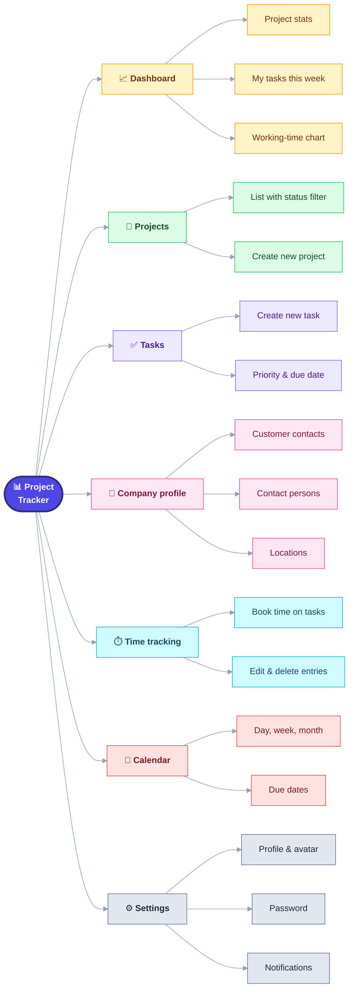
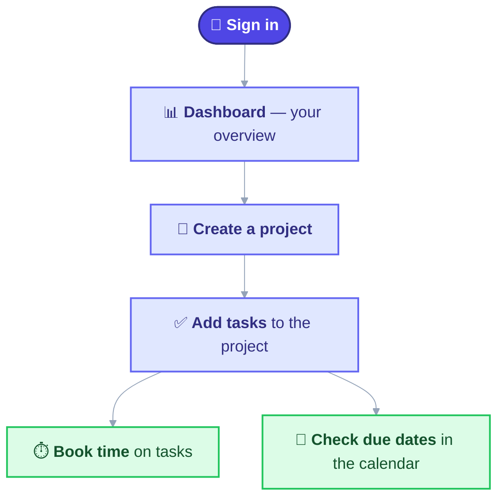
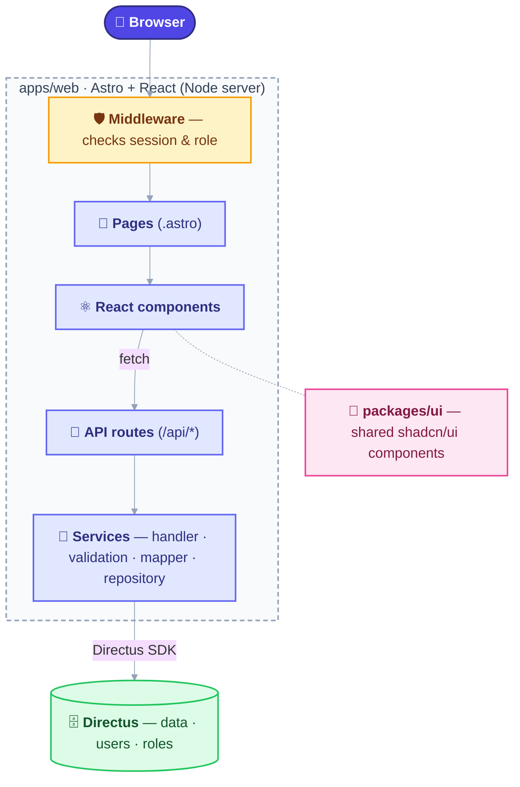
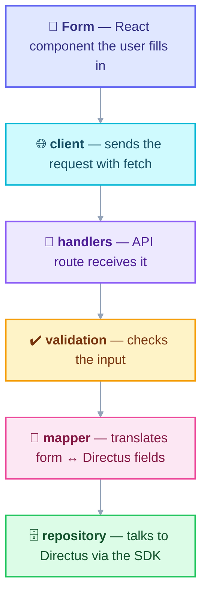

<div align="center">

# 📊 Project Tracker

**Projects, tasks, customers and working hours – all in one place.**
A web app for agencies: the team keeps track of everything, customers see the status of their projects.


[Features](#-features) · [Quick start](#-quick-start) · [Usage](#️-usage) · [Architecture](#️-architecture) · [Development](#️-development)

</div>

---

## 🎯 What is it?

Project Tracker is an internal project management tool. In everyday work it answers three questions:

| Question | Where do I find the answer? |
| -------- | --------------------------- |
| *What are we working on right now?* | **Dashboard**, **Projects**, **Tasks** |
| *How much time goes into which project?* | **Time tracking**, weekly chart on the dashboard |
| *What is due when?* | **Calendar** |

The app is only the user interface. All data lives in a **[Directus](https://directus.io)** backend, which also manages users and roles.

## ✨ Features



- **Dashboard** – key figures, this week's tasks, booked working time and customer contacts at a glance.
- **Projects** – list with status filter and a form for new projects.
- **Tasks** – tasks with priority and due date, which can also be created straight from a project.
- **Company profile** – customer companies with contact persons, locations and notes.
- **Time tracking** – book working time on tasks, edit and delete entries.
- **Calendar** – due dates in day, week and month view.
- **Settings** – profile data, avatar, password and notifications.
- **Roles and permissions** – customers only see what is meant for them.
- **Bilingual** – German (default) and English.

## 👥 Roles

| Role | Dashboard | Projects | Tasks | Company profile | Time | Calendar | Settings |
| ---- | :-------: | :------: | :---: | :-------------: | :--: | :------: | :------: |
| **Administrator** | ✅ | ✅ | ✅ | ✅ | ✅ | ✅ | ✅ |
| **Agentur Mitarbeiter** (agency employee) | ✅ | ✅ | ✅ | ✅ | ✅ | ✅ | ✅ |
| **Kunden** (customer) | ✅ | ✅ | ❌ | ❌ | ❌ | ❌ | ❌ |

With an unknown or missing role the app only shows the dashboard. Tasks and time entries are also blocked for customers in the API (HTTP 403).

> The role names are matched exactly as written above, so create them with these names in Directus.

## 🚀 Quick start

**Requirements:** [Node.js](https://nodejs.org) ≥ 22.12 and a reachable Directus instance.

```bash
# 1. Install dependencies
npm install

# 2. Add your credentials
cp apps/web/.env.example apps/web/.env

# 3. Start the development server
npm run dev
```

The app is then available at the address Astro prints in the terminal (usually <http://localhost:4321>).

### Configuration

In `apps/web/.env`:

| Variable | Meaning |
| -------- | ------- |
| `DIRECTUS_URL` | Address of your Directus instance, e.g. `https://directus.example.com` |
| `DIRECTUS_TOKEN` | Static access token of a Directus user |

> 🔒 The `.env` file contains credentials. Never commit it to Git.

### Production

```bash
npm run build   # build the app
npm run start   # start the Node server (apps/web/dist/server/entry.mjs)
```

The time zone is fixed to `Europe/Berlin`, so due dates and working hours look the same everywhere.

## 🖱️ Usage

### Workflow at a glance



### Step by step

1. **Sign in** – Enter your email and password on `/login`. With "stay signed in" the session lasts longer.
2. **Find your way around** – Use the sidebar on the left to switch between areas. There you can also switch teams and open your profile.
3. **Create a project** – Under **Projects**, click the create button. Fill in basics, schedule and notes, then save.
4. **Add tasks** – Under **Tasks**, create a new task, assign it to a project and set priority and due date.
5. **Book time** – Under **Time tracking**, book working time on a task. Entries can be edited or deleted later.
6. **Check due dates** – In the **Calendar**, switch between day, week and month. If a day has many entries, "more" shows the full list.
7. **Personalise** – Under **Settings**, change your profile, avatar, password and notifications.

### Pages

| Area | Address | Purpose |
| ---- | ------- | ------- |
| Dashboard | `/` | Overview |
| Projects | `/projects` | Project list, new project |
| Tasks | `/tasks` | Task management |
| Company profile | `/company-profile` | Customers, contact persons, locations |
| Time tracking | `/time-tracking` | Working hours |
| Calendar | `/calendar` | Due dates |
| Settings | `/settings` | Profile and account |

## 🏗️ Architecture



Every request first passes through the **middleware**. It checks the sign-in, renews sessions automatically and loads the role. Only `/login` is public. The API routes talk to Directus with the signed-in user's token, so Directus itself checks permissions on every access.

### Anatomy of a feature

Every feature (projects, tasks, time entries …) is layered the same way, from the form down to the database:



### Folder structure

```text
Project-Manager/
├── apps/
│   └── web/                     The application
│       └── src/
│           ├── pages/           Pages and API routes (/api/*)
│           ├── components/      React components per area
│           ├── services/        Business logic per feature
│           ├── lib/             Auth, roles, navigation, helpers
│           ├── hooks/           React hooks
│           ├── i18n/            Texts in German / English
│           └── middleware.ts    Session and access protection
├── packages/
│   └── ui/                      Shared shadcn/ui building blocks
├── docs/                        Plans and drafts
├── turbo.json                   Monorepo tasks (Turborepo)
└── package.json                 npm workspaces
```

### Tech stack

| Area | Used |
| ---- | ---- |
| Framework | [Astro](https://astro.build) 7 (server rendering, Node adapter) |
| UI | [React](https://react.dev) 19, [shadcn/ui](https://ui.shadcn.com), [Tailwind CSS](https://tailwindcss.com) 4 |
| Tables / state | TanStack Table, Zustand |
| Backend | [Directus](https://directus.io) via `@directus/sdk` |
| Language | TypeScript |
| Quality | ESLint, Prettier, Vitest |
| Monorepo | npm workspaces and Turborepo |

## 🛠️ Development

Run all commands from the repository root:

| Command | Effect |
| ------- | ------ |
| `npm run dev` | Development server |
| `npm run build` | Production build |
| `npm run start` | Start the built server |
| `npm run test` | Tests (Vitest) |
| `npm run lint` | Lint the code (ESLint) |
| `npm run typecheck` | Check types |
| `npm run format` | Format the code (Prettier) |

### Add a shadcn/ui component

```bash
npx shadcn@latest add button -c apps/web
```

### Add a new page

Menu entries are defined in one place only: [`apps/web/src/lib/navigation.ts`](apps/web/src/lib/navigation.ts). The sidebar and the role permissions ([`roles.ts`](apps/web/src/lib/auth/roles.ts)) are derived from it.
